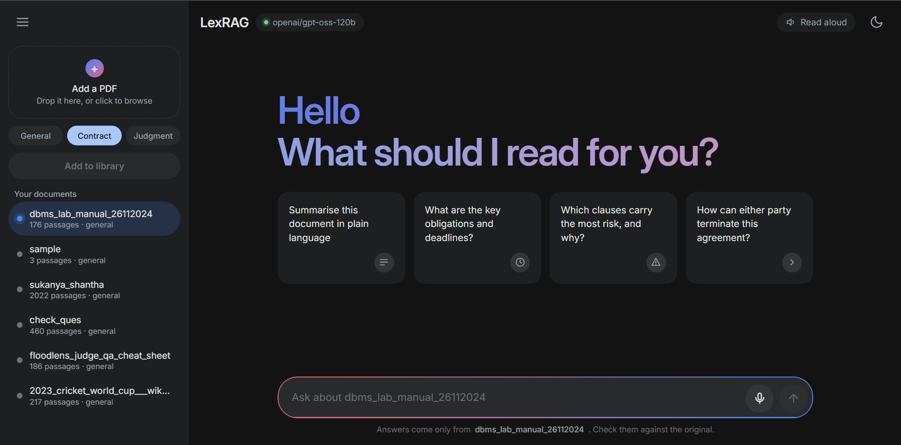

# LexRAG: Legal Document Assistant

Upload a legal PDF, ask questions in plain English, and get answers grounded in that document, with the exact source passages shown next to every answer. If the document doesn't contain the answer, LexRAG says so instead of guessing.

**Demo:** [60-second video](https://youtu.be/D4QRY-M-ZTg) 



## Results

### Compared with ChatGPT and Gemini

Informal test on *Sukanya Shantha v. Union of India* [2024] INSC 753: one judgment, a handful of questions, response times measured by hand.

| | LexRAG | ChatGPT | Gemini |
|---|---|---|---|
| Questions answered in the document | Correct | Correct | Correct |
| Questions the document cannot answer (events after the judgment) | "I cannot find this information" | Long answer from general knowledge | Long answer from general knowledge |
| Shows source passages with relevance scores | Yes | No | No |
| Response time | 2.5-3.1 s | 2.3-3.5 s | 6-9 s |

The point is not that the other tools are wrong. When they answer from general knowledge, you cannot tell which parts came from your document. LexRAG only answers from the passages it retrieved, and shows them.

### RAGAS evaluation

5 questions on one NDA, scored with the RAGAS framework (LLM-as-judge):

| Metric | Score | Measures |
|---|---|---|
| Faithfulness | 1.00 | Answer is supported by the retrieved text |
| Answer relevancy | 0.98 | Answer addresses the question |
| Context recall | 1.00 | The needed passages were retrieved |

Context precision timed out because of Groq free-tier rate limits, so it has no score. These numbers come from an earlier version of the pipeline (before the model change and per-document collections), and the test set is small. See Limitations.

## What it does

- Chunks documents differently by type: contracts by section headings, court judgments by meaning shifts (semantic chunking), everything else by paragraph and sentence boundaries
- Hybrid search: vector search for meaning, BM25 for exact terms such as section numbers, merged with Reciprocal Rank Fusion
- Cross-encoder reranking of the candidates before they reach the LLM
- Answers streamed token by token, with source passages and relevance scores
- Multiple documents, each in its own ChromaDB collection, switchable from the sidebar
- Basic protections: rate limiting, upload size limit, question length limit, query cache

## Architecture

```
PDF upload
  -> text extraction (PyMuPDF4LLM, clean markdown)
  -> chunking by document type
       contract  : split on headings, then recursive
       judgment  : semantic chunking
       general   : recursive character splitting
  -> embeddings (all-MiniLM-L6-v2) -> ChromaDB, one collection per document

Question
  -> hybrid retrieval: vector + BM25, merged with RRF (top 20 candidates)
  -> cross-encoder reranking (top 5)
  -> grounded prompt -> Groq (openai/gpt-oss-120b), streamed
  -> answer + source passages with relevance scores
```

## Design decisions

**Hybrid search.** Legal text is full of exact references ("Section 4.2(b)", "Article 17"). Embeddings capture meaning but handle rare exact tokens poorly, while BM25 does the opposite. Merging both rankings with RRF means a passage that ranks well in either list is not lost.

**Two-stage retrieval.** A bi-encoder is fast but approximate, because it embeds the question and passage separately. A cross-encoder reads them together and scores relevance more precisely, but is too slow to run over everything. So the bi-encoder and BM25 pick candidates and the cross-encoder picks the final passages.

**Chunking by document type.** On a 213-page US Supreme Court opinion, plain recursive chunking missed several questions. Semantic chunking fixed several of them. Contracts have explicit headings, so splitting on them keeps each clause in one chunk.

**Grounded prompt, temperature 0.** The prompt tells the model to answer only from the supplied passages and to say so when the answer is missing. That is what makes it refuse the questions the document cannot answer.

**One collection per document.** Early on, all documents shared one collection, so a question about one case returned passages from another. Each document now has its own collection and you choose which one to query.

## Tech stack

| Part | Choice |
|---|---|
| Backend | FastAPI, async, streaming responses |
| Vector store | ChromaDB (persistent) |
| Embeddings | all-MiniLM-L6-v2 (sentence-transformers) |
| Keyword search | BM25 (rank-bm25) |
| Reranker | cross-encoder/ms-marco-MiniLM-L-6-v2 |
| LLM | openai/gpt-oss-120b on Groq |
| PDF parsing | PyMuPDF4LLM |
| Evaluation | RAGAS |

## Limitations

- **Retrieval is sensitive to wording.** "Who wrote the majority opinion?" can miss a passage that says "delivered the opinion of the Court". Query rewriting or multi-query retrieval is the planned fix.
- **Small evaluation.** 5 questions on one NDA, and the three-way comparison is one judgment. It is a first signal, not a benchmark.
- **Text PDFs only.** No OCR for scanned documents, and English works best.
- **Not hardened.** The BM25 index and query cache live in memory, and there is no authentication, so anyone who can reach the app can upload documents.
- **Privacy.** The full document stays on the server, but the question and the top retrieved passages are sent to the Groq API to generate the answer.

## Run locally

```bash
git clone https://github.com/arsh-13579/LexRAG.git
cd LexRAG

python -m venv venv            # Python 3.11 recommended
venv\Scripts\activate          # Windows
# source venv/bin/activate     # macOS / Linux

pip install -r requirements.txt
copy .env.example .env         # use cp on macOS / Linux, then add your GROQ_API_KEY
uvicorn main:app --port 8000
```

Open http://localhost:8000. The first run downloads two small models (about 200 MB).

## API

| Endpoint | Purpose |
|---|---|
| `GET /health` | Server status |
| `GET /documents` | List ingested documents |
| `POST /select-document/{doc_id}` | Choose the document to query |
| `POST /ingest` | Upload a PDF (`document_type`: general, contract, judgment) |
| `POST /query` | Question in, answer and sources out |
| `POST /query-stream` | Same, streamed token by token |

## Next steps

- Query rewriting and multi-query retrieval to reduce wording sensitivity
- A larger evaluation set (20-50 questions) and re-running RAGAS on the current pipeline
- Docker and a public deployment
- Authentication, and a persistent cache

Built by Mohammad Arsh | [LinkedIn](ADD_LINKEDIN_LINK) | [GitHub](https://github.com/arsh-13579)
